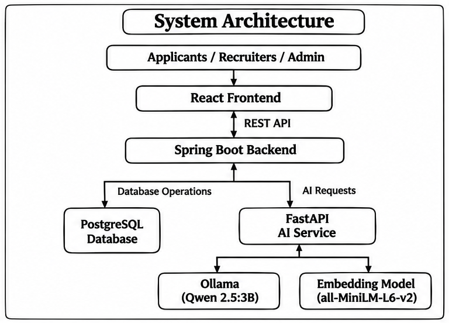
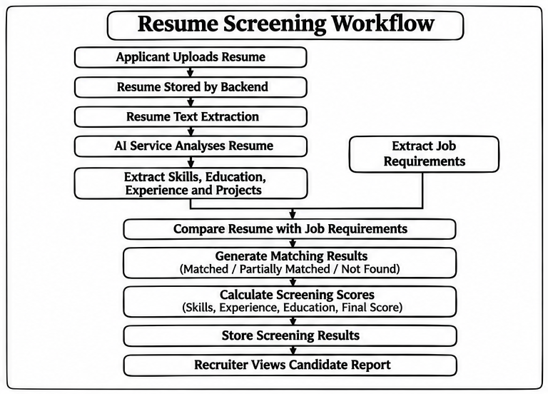
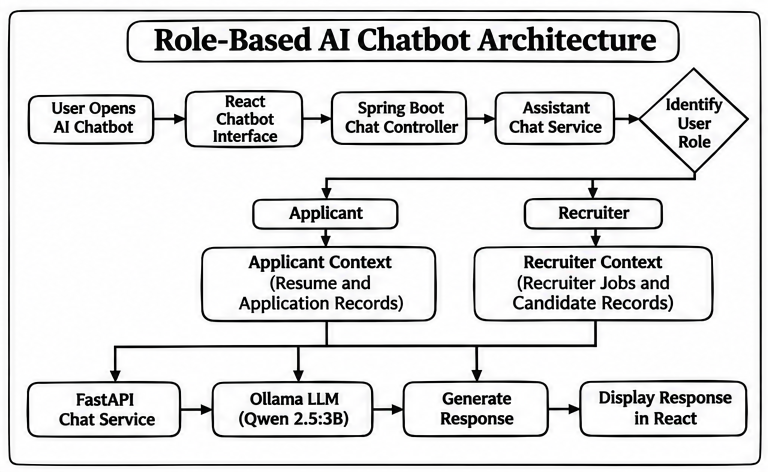
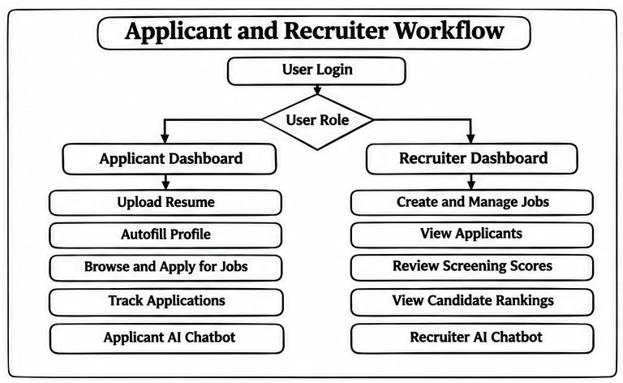

# Resume Screening System

## About the Project

The Resume Screening System is a project developed to make the recruitment process a little easier for both applicants and recruiters.

During recruitment, recruiters often receive a large number of resumes for a single job opening. Going through each resume manually and checking whether a candidate meets the job requirements can take quite a lot of time.

The idea behind this project is to use AI to help with that process. The application allows applicants to upload their resumes, explore job opportunities, and track their applications. Recruiters can post jobs, view applicants, and get AI-based results that help them understand how closely a candidate's resume matches a job description.

I have also worked on adding separate AI chatbots for applicants and recruiters, so users can get information based on their role.

## What the Application Offers

### Applicant Side

Applicants can:
- Create an account and log in.
- Manage their profile.
- Upload their resumes.
- Extract information from their resumes and use it to autofill profile details.
- Browse available job openings.
- Apply for jobs.
- Check the status of their applications.
- Use the AI chatbot for questions related to their resume and applications.

### Recruiter Side

Recruiters can:
- Create an account and log in.
- Create and manage job postings.
- View candidates who have applied for their jobs.
- Access candidate resumes.
- Check AI-generated screening results and matching scores.
- View candidate rankings.
- Use the AI chatbot to get information about jobs and applicants.

## AI-Based Resume Screening

This is one of the main parts of the project.

When an applicant uploads a resume, the system extracts important information such as skills, education, work experience, projects, and certifications.

The extracted information is then compared with the requirements mentioned in the job description. Based on this comparison, the system generates matching results and screening scores.

This gives recruiters a quicker way to review candidates instead of having to manually compare every resume with the job requirements.

## System Architecture

The project is divided into different services, with each one handling a particular part of the application.

React is used for the frontend, Spring Boot handles the main backend operations, and FastAPI is used for AI-related processing. PostgreSQL is used to store application data.

Here is an overview of how the different components are connected.



### Technologies Used

| Component | Technology |
|---|---|
| Frontend | React, Vite |
| Backend | Java, Spring Boot |
| AI Service | Python, FastAPI |
| Database | PostgreSQL |
| Language Model | Ollama – Qwen 2.5:3B |
| Embedding Model | all-MiniLM-L6-v2 |
| Authentication | JWT |
| Version Control | Git and GitHub |

## Resume Screening Workflow

The following diagram shows how the resume screening process works, starting from resume upload and ending with the screening results being made available to recruiters.



## Role-Based AI Chatbot

Another feature I worked on is the AI chatbot.

The chatbot behaves differently depending on whether the logged-in user is an applicant or a recruiter.

For example, an applicant can ask questions about their own resume or application status. A recruiter can ask about their job postings, applicants, screening results, and candidate rankings.

The backend provides the chatbot with information relevant to the user's role before the AI service generates a response.



## Applicant and Recruiter Workflow

The application has two different user roles, and each role has its own dashboard.

Applicants can manage their profiles, upload resumes, browse jobs, and track applications. Recruiters can manage job postings, review applicants, and check screening results.

The diagram below gives an overview of the activities available to both users.



## Project Structure

The project is organised into three main folders, along with a folder for the diagrams used in this README.

```text
Resume_Screening_System1/
│
├── frontend/       # React frontend
├── backend/        # Spring Boot backend
├── ai-service/     # FastAPI AI service
├── images/         # Project diagrams
└── README.md
```

## Requirements

To run the project locally, you will need:

- Node.js and npm
- Java JDK
- Python
- PostgreSQL
- Ollama
- Git

The Qwen 2.5:3B model should also be available through Ollama.

## Running the Project

The frontend, backend, and AI service run separately. PostgreSQL and Ollama should also be running.

### 1. Database

Start PostgreSQL and make sure the project database is created and configured.

Set the database username and password using the environment variables expected by the backend.

### 2. Backend

The backend runs on port **8081**.

### 3. AI Service

Activate the Python virtual environment and install the dependencies from `requirements.txt` if needed.

Start the FastAPI application using the configured entry point.

The AI service runs on port **8000**.

### 4. Ollama

Make sure Ollama is installed and running.

If the Qwen model has not been downloaded yet, run:

### 5. Frontend

Install the required packages and start the development server:

The frontend runs on port **5173** by default.

Open the local URL shown in the terminal to access the application.

## Security

JWT authentication is used to manage user access. Applicant and recruiter features are separated based on their roles.

The chatbot also receives role-specific information so that it can provide responses relevant to the logged-in user.

Database passwords and other sensitive configuration values should be kept in environment variables and should not be uploaded to GitHub.

## Future Improvements

There are a few areas where the project could be improved further:

- Improving resume parsing for different formats.
- Making the AI matching process more accurate.
- Adding more recruitment analytics.
- Improving the dashboard experience.
- Supporting additional AI models.

## Conclusion

Building this project gave me an opportunity to work with frontend development, backend services, databases, and AI integration in one application.

The main goal is to reduce the manual effort involved in resume screening and make the recruitment process easier for both applicants and recruiters.


